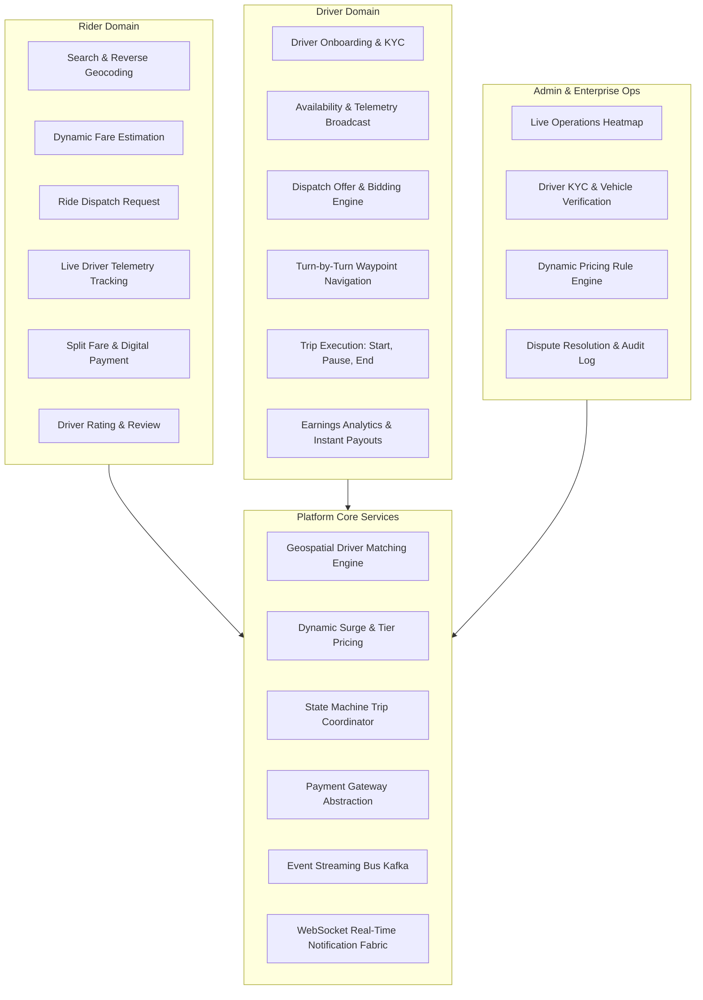
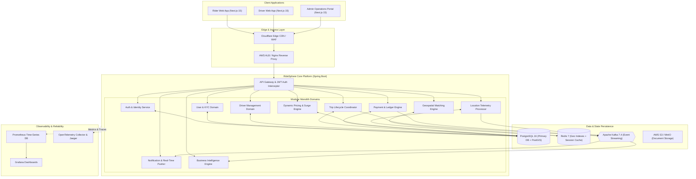

# Urban Ride (RideSphere) - High-Level Design (HLD)

## 1. Executive Summary
Urban Ride (marketed as **RideSphere**) is an enterprise-grade, distributed, intelligent mobility and ride-hailing platform engineered to support high-throughput, low-latency concurrent ride dispatches, real-time driver telemetry streaming, dynamic surge pricing, and resilient financial transactions.

The platform follows a **Modular Monolith First** architecture for rapid cohesion, strict type boundaries, and streamlined operations, with a pre-designed domain boundary migration path toward distributed cloud-native microservices.

---

## 2. Business Architecture & Capabilities

---

## 3. High-Level System Architecture

---

## 4. Key Architectural Patterns & Decisions
1. **Modular Monolith with Domain-Driven Design (DDD)**: Single deployable artifact eliminating distributed transaction failure modes while retaining strict logical boundary isolation (`auth`, `user`, `driver`, `trip`, `pricing`, `matching`, `payment`, `location`).
2. **In-Memory Geospatial Indexing via Redis**: Drivers push coordinates every 3-5 seconds. Redis `GEOADD` and `GEORADIUS` / `GEOSEARCH` enable sub-5ms driver proximity lookup without overwhelming the relational database.
3. **Optimistic Locking & State Machine Integrity**: Trips use an explicit state machine:
   `REQUESTED` $\to$ `MATCHING` $\to$ `ACCEPTED` $\to$ `ARRIVED` $\to$ `IN_PROGRESS` $\to$ `COMPLETED` / `CANCELLED`.
   State transitions are protected with version numbers (`@Version`) preventing double-accept race conditions across competing drivers.
4. **Idempotent Payment Processing**: All payment initiation requests require unique UUID idempotency keys stored in Redis/PostgreSQL with a 120-second lease window.
5. **Decoupled Asynchronous Events via Kafka**: High-volume telemetry and post-trip lifecycle side effects (email invoices, driver payout calculations, fraud audits) emit domain events onto Kafka topics.

---

## 5. Non-Functional Requirements (NFR) Benchmarks
- **Availability**: 99.99% uptime with multi-AZ container deployments.
- **P99 API Latency**: $\le 120\text{ ms}$ for standard REST queries; $\le 50\text{ ms}$ for geolocation pings.
- **Throughput Target**: 10,000 concurrent active trips, 50,000 driver telemetry pings/sec.
- **RTO & RPO**: Recovery Time Objective $\le 15\text{ min}$; Recovery Point Objective $\le 1\text{ min}$.
