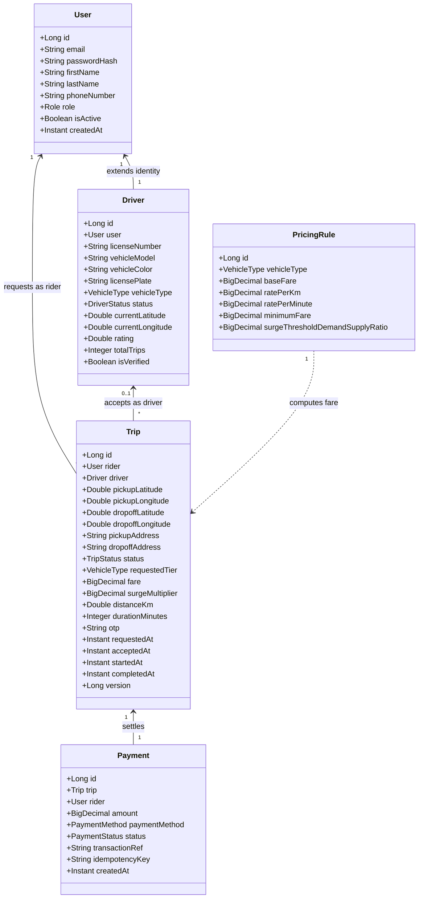
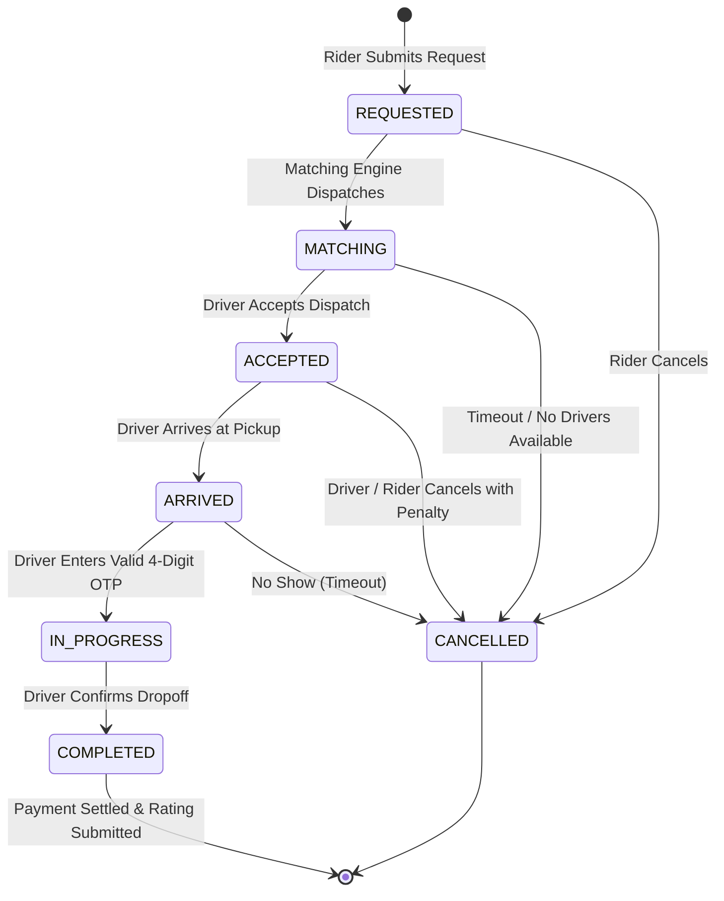

# Urban Ride (RideSphere) - Low-Level Design (LLD)

## 1. Domain Entities & Class Architecture

### 1.1 Class Diagram


---

## 2. State Machine: Trip Lifecycle


---

## 3. Dynamic Pricing Algorithm

The dynamic pricing service computes trip cost based on base fares, distance, estimated travel time, vehicle tier modifiers, and real-time demand-supply surge:

$$\text{Fare} = \max\left(\text{MinFare}, \left(\text{BaseFare} + (\text{Distance}_{\text{km}} \times \text{Rate}_{\text{km}}) + (\text{Duration}_{\text{min}} \times \text{Rate}_{\text{min}})\right) \times \text{TierMultiplier} \times \text{SurgeFactor}\right)$$

### Surge Factor Calculation
$$\text{DemandSupplyRatio} = \frac{\text{ActiveRequests}_{r}}{\max(1, \text{OnlineDrivers}_{r})}$$

$$\text{SurgeFactor} = 
\begin{cases} 
1.0 & \text{if } \text{DemandSupplyRatio} \le 1.2 \\
1.0 + 0.25 \times (\text{DemandSupplyRatio} - 1.2) & \text{if } 1.2 < \text{DemandSupplyRatio} \le 3.0 \\
2.5 & \text{if } \text{DemandSupplyRatio} > 3.0 \text{ (Capped for regulatory compliance)}
\end{cases}$$

---

## 4. Geospatial Proximity & Matching Algorithm
1. **Spatial Ingestion**: Every active driver streams continuous coordinates `(lat, lon)` over WebSocket `/ws-ride/location` or `POST /api/v1/location/update`.
2. **Redis Geo Storage**: Key `geo:drivers:available:{vehicleType}` stores coordinates:
   ```redis
   GEOADD geo:drivers:available:COMFORT 77.5946 12.9716 driver_102
   ```
3. **Proximity Search**:
   ```redis
   GEORADIUS geo:drivers:available:COMFORT 77.5946 12.9716 5 km WITHCOORD WITHDIST ASC COUNT 10
   ```
4. **Ranking Heuristic**:
   $$\text{Score} = (w_1 \times \text{ProximityRank}) + (w_2 \times \text{DriverRating}) + (w_3 \times \text{AcceptanceRate})$$
   Candidate driver with the lowest composite score is offered the trip first with a 15-second response window.
